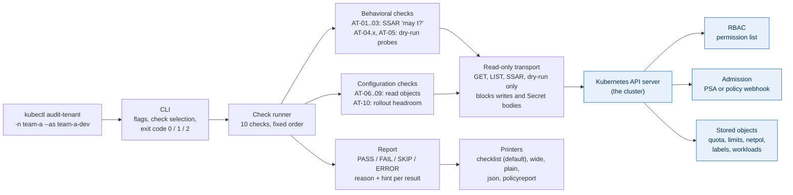

# kubectl audit-tenant: design

Status: **draft v0** (2026-10-10). Written in the spec session; goes to `/plan-ceo-review` and `/plan-eng-review` next. Decisions with a number (ADR 0001 to 0009) live in `docs/adr/`. Terms are defined in `GLOSSARY.md`.

Terms used below. AT: the prefix of every check ID (`AT-01` to `AT-10`); it stands for audit-tenant. SSAR: SelfSubjectAccessReview, an API call that asks the cluster "may this identity do X?" and does nothing. Dry-run: a create request with `dryRun=All`; the server runs every gate and stores nothing. Admission: the gate that inspects a new object before it is saved. PSA: Pod Security Admission, the built-in pod gate switched on by a namespace label. MTB: the archived Kubernetes Multi-Tenancy Benchmarks. PolicyReport: the `wgpolicyk8s.io` report object that policy dashboards read.

## 1. Problem

A platform team runs one Kubernetes cluster for many teams ("tenants"). Security and auditors ask: "prove that team A cannot touch team B". Tenants ask: "is my namespace set up right, and why was my pod rejected?". Today nobody can answer from the tenant's side. Admin-side scanners (Kyverno audit mode, Kubescape, Polaris, Popeye) infer what a tenant could do from rules; they never ask the cluster as the tenant. Permission viewers (rbac-tool, who-can, rakkess) show RBAC only. The community tool that did ask as the tenant, `kubectl-mtb`, is archived (last release December 2021) and predates PSA. `kuota-calc` computes a quota from manifests but never compares it with the live namespace. Checked 2026-10-10: krew lists 411 plugins; none runs as the tenant.

`kubectl audit-tenant` runs ten checks as the tenant identity against one namespace and prints one verdict per check, with the layer that decided it, the matching MTB ID, a reason, and a hint. It never changes the cluster.

## 2. Users and first adopters

**Primary user: the platform team.** Mature platforms hide Kubernetes from application teams; many tenants never hold a kubeconfig, and a rejected pod becomes a message in the platform team's chat channel, not a kubectl error. For those platforms this tool is a test of the platform's own fences. The provisioning pipeline runs it right after it creates a namespace, impersonating the new tenant's identity, and fails the pipeline on a FAIL. Security or an auditor runs it on demand against any namespace and gets one page with a public benchmark ID per line. The team that wrote the guardrails should not be the only proof that they work; this checks their automation from the outside, the way an integration test checks code.

**Secondary users: tenants who do hold a kubeconfig.** Most namespace-per-team clusters on EKS, GKE and AKS, Capsule tenants and Rancher projects still hand out kubectl. Those teams run it against their own namespace with no special permission and read why a pod was rejected instead of asking in a channel.

**Why not build these checks into the platform's deploy code?** Good platforms do. This tool is the independent check on those checks: a standard list that names each fence with a public benchmark ID, runs in ten seconds against any cluster, and does not depend on the platform's own code being right. Teams that have the guardrails use it as the test. Teams that do not have them yet use it as the list.

| User | Runs it how | Wants |
|---|---|---|
| Platform engineer, at tenant onboarding | pipeline step: `kubectl audit-tenant -n team-a --as team-a-admin -o json`, exit code gates the step | Proof that the new namespace is fenced before the tenant gets it |
| Security or auditor | `kubectl audit-tenant -n team-a --as team-a-admin` | One page of PASS/FAIL with benchmark IDs, repeatable next quarter |
| Tenant team with kubectl | `kubectl audit-tenant -n team-a` with its own kubeconfig | "Is my namespace governed?" and "why was my pod rejected?" |
| Policy dashboard owner | `-o policyreport \| kubectl apply -f -` | The verdicts next to Kyverno results in Policy Reporter |

First adopters: three platform engineers at other companies (interviewed before the build goes far, see section 10), community meetup members with shared clusters, and Capsule users. The quick start must work on a kind cluster in five minutes.

## 3. Scope (v0.1)

**In.** Ten checks (section 5). Two identity modes: self (current kubeconfig identity) and impersonation (`--as`, `--as-group`). Four verdicts: PASS, FAIL, SKIP, ERROR (ADR 0004). Outputs: checklist (default), `-o wide`, `--plain`, `-o json`, `-o policyreport`. Exit codes for CI. Subcommands `list-checks` and `version`. Binaries for darwin and linux (amd64, arm64) and windows/amd64. krew manifest. Unit, envtest and kind end-to-end tests.

**Out (goes to `TODOS.md` as "later").** Network behavior tests (need running pods). Writing the PolicyReport into the cluster. Capsule `Tenant` discovery. SARIF. Gatekeeper constraint mapping. Helm chart or operator. Many namespaces or clusters in one run. `--baseline` file (v0.2). DaemonSets, Jobs, CronJobs and bare Pods in the headroom math (ADR 0006). Cloud lookups for service principals (ADR 0009). Checking whether the network plugin enforces NetworkPolicy.

**Fallback.** If v0.1.0 is not tagged by 2026-10-31, tag with whatever passes, minimum AT-01, 02, 04, 06, 09, 10. The README's check table shows only shipped checks.

## 4. Architecture



Rendered copies: `docs/diagrams/architecture.svg` and `.png`. Editable scene: `docs/diagrams/architecture.excalidraw` (open at excalidraw.com). Source of truth: `docs/diagrams/architecture.mmd`.

Rules that shape the code:

- **Read-only by construction (ADR 0001).** `internal/safety.Transport` wraps the REST transport. It allows GET; POST only to `selfsubjectaccessreviews`, `selfsubjectreviews`, and to `pods` or `services` in the target namespace when the query has `dryRun=All`. It blocks any request to a Secret body (GET or LIST of `secrets`). Anything else returns an error before it leaves the process and is a bug. A unit test replays every check against a recording transport and asserts the allowlist.
- **Run as the tenant (ADR 0002).** Behavioral checks ask the cluster. The tool never reads Roles or policies to guess.
- **Fixed order, sequential.** Checks run one after another in ID order. About 35 requests per run. No concurrency in v0.1; a full run on kind must finish in under 10 seconds (section 7).
- **One `--timeout` (default 30s)** bounds the whole run through a context deadline.
- **No dependency on Argo.** Rollouts are read through the dynamic client as unstructured objects (`argoproj.io/v1alpha1`, `rollouts`) only when discovery shows the CRD. No Argo Go module.
- **Go style.** Code follows the JetBrains modern Go guidelines (agent skill `/modern-go-guidelines:use-modern-go`, loaded before any Go is written) and `golangci-lint` enforces what it can.
- **Stdlib first.** `text/tabwriter` for columns, `golang.org/x/term` (already a client-go dependency) to detect a terminal, hand-written ANSI for the four colors. No table or color library.

Go module: `github.com/BodhiSatvik/kubectl-audit-tenant`. Go 1.26. `k8s.io/client-go`, `k8s.io/api`, `k8s.io/apimachinery`, `k8s.io/cli-runtime` v0.37.x. `github.com/spf13/cobra`. Supported servers: Kubernetes 1.28 and newer (SelfSubjectReview is GA from 1.28). Import `_ "k8s.io/client-go/plugin/pkg/client/auth"` so cloud logins work (krew best practice).

### Package layout

| Path | Holds |
|---|---|
| `cmd/kubectl-audit_tenant/main.go` | Entry point. Binary name follows the krew rule (dash becomes underscore). |
| `internal/cli/` | cobra commands `audit-tenant` (run), `list-checks`, `version`; flag validation; exit codes |
| `internal/cluster/` | Client construction, identity lookup, server version |
| `internal/safety/` | The read-only transport and its tests |
| `internal/checks/` | `Check` interface, registry, `at01.go` to `at10.go`, MTB mapping table, severities |
| `internal/probe/` | Probe builders (control pod, 5 dangerous pods, NodePort service), rejection classifier |
| `internal/headroom/` | Pure functions for AT-10: peak per workload, pod request math, quota comparison |
| `internal/report/` | `Report` and `Result` types; the five printers |
| `test/e2e/` | kind config, fixtures, Kyverno policy, expected verdicts, run script |
| `.github/workflows/` | `ci.yml` (vet, lint, unit, envtest), `e2e.yml` (kind), `release.yml` (goreleaser) |
| `.goreleaser.yaml`, `.krew.yaml` | Release and krew manifest template |

## 5. The checks

Severity is static per check and appears in `-o json`, `-o policyreport`, and `list-checks`. Every non-PASS result carries a reason (the cluster's own text where possible) and a hint.

| ID | Name | Kind | MTB | Severity | Method | PASS when |
|---|---|---|---|---|---|---|
| AT-01 | No cluster-scoped access | behavioral | MTB-PL1-CC-CPI-1 | high | SSAR: `list nodes`, `create namespaces`, `create clusterrolebindings`, `create persistentvolumes` | all four denied |
| AT-02 | No cross-namespace secret access | behavioral | MTB-PL1-CC-TI-2 | high | SSAR: `get secrets` and `list secrets` in `--other-namespace` (default `kube-system`) | both denied |
| AT-03 | No privilege escalation | behavioral | MTB-PL2-CC-TI-1 | high | SSAR: `escalate` and `bind` on `roles` (in the namespace) and `clusterroles`; `impersonate` on `users`, `groups`, `serviceaccounts`; `*` on `*` cluster-wide | all denied. The in-namespace wildcard is **not** tested: a namespace-scoped `*/*` role is a common, legitimate tenant-admin pattern |
| AT-04.1 | Privileged container blocked | behavioral | MTB-PL1-BC-CPI-5 | high | dry-run pod with `privileged: true` | rejected by admission or RBAC |
| AT-04.2 | hostPath volume blocked | behavioral | MTB-PL1-BC-HI-1 | high | dry-run pod with a `hostPath` volume | rejected |
| AT-04.3 | hostPID blocked | behavioral | MTB-PL1-BC-HI-4 | high | dry-run pod with `hostPID: true` | rejected |
| AT-04.4 | hostNetwork blocked | behavioral | MTB-PL1-BC-HI-3 | high | dry-run pod with `hostNetwork: true` | rejected |
| AT-04.5 | Privilege escalation to root blocked | behavioral | MTB-PL1-BC-CPI-6 | high | dry-run pod with `allowPrivilegeEscalation: true`, `runAsUser: 0`, `runAsNonRoot: false` | rejected |
| AT-05 | NodePort services blocked | behavioral | MTB-PL1-BC-HI-1 (shared upstream ID; mapped by title) | medium | dry-run `Service` with `type: NodePort` | rejected by admission or RBAC |
| AT-06 | ResourceQuota present and complete | config | MTB-PL1-CC-FNS-1 | medium | LIST resourcequotas | at least one quota with no `scopes`/`scopeSelector` whose `hard` has `requests.cpu` (or `cpu`), `requests.memory` (or `memory`), `limits.cpu`, `limits.memory`, `pods` |
| AT-07 | LimitRange with defaults | config | - | low | LIST limitranges | an item of type `Container` with `default` and `defaultRequest` for both cpu and memory |
| AT-08 | Default-deny NetworkPolicy | config | - | medium | LIST networkpolicies | a policy with empty `podSelector`, `Ingress` in `policyTypes`, no `ingress` rules; AND a policy (same or other) with empty `podSelector`, `Egress` in `policyTypes`, no `egress` rules. Other policies do not affect the verdict. Reason notes the tool cannot see whether the network plugin enforces policies |
| AT-09 | Pod Security Admission enforced | config | - | high | GET namespace labels | `pod-security.kubernetes.io/enforce` is `baseline` or `restricted` (ADR 0007). Forbidden to read: SKIP with hint |
| AT-10 | Quota covers rollout peak | computed | - | low | LIST deployments, statefulsets, horizontalpodautoscalers, resourcequotas, limitranges; LIST rollouts if the CRD exists | the summed rollout peak fits in every unscoped quota's `hard` for `requests.cpu`, `requests.memory`, `limits.cpu`, `limits.memory`, `pods` (ADR 0006) |

`--checks AT-04` selects all five sub-checks. `list-checks` prints ID, kind, MTB, severity, name, and the method in one line each.

### Probes (AT-04, AT-05), ADR 0005

- Image `registry.k8s.io/pause:3.10` (never pulled: dry-run stores nothing). Container `probe`, requests and limits `1m` CPU and `1Mi` memory. `generateName: audit-tenant-probe-`, label `app.kubernetes.io/managed-by: audit-tenant`, annotation `audit-tenant.dev/probe: "true"`.
- The **control pod** is PSA-restricted compliant: `runAsNonRoot: true`, `runAsUser: 65532`, `allowPrivilegeEscalation: false`, `capabilities.drop: ["ALL"]`, `seccompProfile: RuntimeDefault`. Each dangerous probe is the control pod plus exactly one dangerous attribute.
- Order: control pod first. If it is rejected, AT-04.1 to AT-04.5 and AT-05 are SKIP with the control's rejection text and the hint "the namespace rejects even a compliant pod; fix that first (reason above)". If the identity lacks `create pods` (403 with no admission text), AT-04.x PASS with layer RBAC and the note "admission was not exercised".
- **Classifier** on the rejection: message contains `violates PodSecurity` → admission (PSA); contains `admission webhook` and `denied` → admission (policy engine, webhook name kept); HTTP 403 with no admission text → RBAC; contains `exceeded quota`, `must specify`, `forbidden: maximum`, `forbidden: minimum` (quota or LimitRange text) → inconclusive → SKIP with hint; HTTP 400 or 422 `Invalid` → ERROR (a bug in our probe); webhook refuses dry-run (`does not support dry run` or `sideEffects`) → SKIP with hint naming the webhook.
- AT-05 service: `type: NodePort`, one port 80/TCP, no selector, same generateName and labels.

### Headroom math (AT-10), ADR 0006

- Counted: Deployments, StatefulSets, Argo Rollouts (if the CRD exists). Not counted: DaemonSets, Jobs, CronJobs, bare Pods. The reason shows each quota's `used` values so the reader sees what else consumes it.
- Replicas: `spec.replicas` (default 1). If a `HorizontalPodAutoscaler` (autoscaling/v2) targets the workload, use its `maxReplicas` instead.
- Peak pods: Deployment RollingUpdate = replicas + maxSurge (absolute, or percent of replicas rounded up; default 25%); Deployment Recreate = replicas; StatefulSet = replicas; Rollout blueGreen = replicas + (`previewReplicaCount` if set, else replicas); Rollout canary = replicas + maxSurge (default 25%).
- Pod request and limit: Kubernetes rule, max(sum of regular containers, largest init container); init containers with `restartPolicy: Always` count as regular. A container with no request or limit takes the LimitRange `defaultRequest` or `default` for type Container if one exists, else 0, and the reason says "N containers had no request; counted as 0".
- Compare: for every unscoped ResourceQuota and each of the five keys it defines, peak sum ≤ hard. FAIL reason: `peak needs 6 cpu, hard is 4 cpu, short by 2 (deployments: api 3→4, worker 2→3)`. Assumes all workloads roll out at once; the reason says so.

## 6. Interfaces

### Command surface

```
kubectl audit-tenant -n NAMESPACE [--as USER] [--as-group GROUP ...]
                     [-o checklist|wide|json|policyreport] [--plain] [--no-color]
                     [--checks ID,...] [--skip ID,...]
                     [--other-namespace kube-system] [--timeout 30s]
kubectl audit-tenant list-checks [-o table|json]
kubectl audit-tenant version
```

Also honored: `--kubeconfig`, `--context`, `--cluster`, `--user`, `--request-timeout` (from cli-runtime), `KUBECONFIG`, `NO_COLOR`. `-h`/`--help` usage text starts with `kubectl audit-tenant`.

### Exit codes (ADR 0004)

| Code | When |
|---|---|
| 0 | No FAIL and no ERROR. SKIPs allowed. |
| 1 | At least one FAIL. |
| 2 | At least one ERROR and no FAIL; or the run could not start: bad flags (`--as-group` without `--as`, unknown check ID, unknown `-o`), kubeconfig cannot load, API server unreachable, or the identity may not create SelfSubjectAccessReviews. Each with a one-line reason and hint on stderr. |

### Checklist output (default, chosen in the spec session)

```
namespace team-a · as team-a-dev (groups: team-a, system:authenticated) · cluster kind-dev

PASS  AT-01  No cluster-scoped access            RBAC denied all 4 actions
FAIL  AT-05  NodePort services blocked           a NodePort Service was accepted in a dry run
      fix    add a policy that rejects type: NodePort, or remove `create services` from the tenant role
SKIP  AT-09  Pod Security Admission enforced     cannot read namespace labels (forbidden)
      fix    grant `get` on namespace team-a to this identity, or run with --as <admin>

8 passed · 1 failed (AT-05) · 1 skipped (AT-09) · 0 errors · exit 1
MTB IDs and layers: -o wide · machine output: -o json, -o policyreport
```

Rules: one line per result in ID order; AT-04 prints its five sub-results; a `fix` line under every FAIL, SKIP and ERROR; header line names namespace, identity (with `(unverified)` when SelfSubjectReview failed, `(self)` without `--as`) and cluster context; the last line is the summary with the exit code; the line after it names the next commands. Color (green, red, yellow, magenta for ERROR) only when stdout is a terminal, `NO_COLOR` is unset and `--no-color` is absent. `--plain` removes color and the `·` separators (ASCII only). In self mode, when AT-03's cluster-wide wildcard is allowed, the header adds: `this identity looks like a cluster admin; add --as to test a tenant`.

`-o wide` adds two columns after the ID: MTB ID and deciding layer (`RBAC`, `admission (PSA)`, `admission (webhook: kyverno-...)`, `config`, `-`).

### JSON (`-o json`)

```json
{
  "apiVersion": "audit-tenant.dev/v1alpha1",
  "tool": {"name": "audit-tenant", "version": "0.1.0"},
  "cluster": {"context": "kind-dev", "server": "https://127.0.0.1:6443", "version": "v1.37.0"},
  "namespace": "team-a",
  "otherNamespace": "kube-system",
  "identity": {"mode": "impersonation", "username": "team-a-dev", "groups": ["team-a", "system:authenticated"], "verified": true},
  "timestamp": "2026-10-20T15:04:05Z",
  "results": [
    {"id": "AT-05", "name": "NodePort services blocked", "kind": "behavioral", "mtb": "MTB-PL1-BC-HI-1",
     "severity": "medium", "verdict": "FAIL", "layer": "-",
     "reason": "a NodePort Service was accepted in a dry run",
     "hint": "add a policy that rejects type: NodePort, or remove `create services` from the tenant role"}
  ],
  "summary": {"pass": 8, "fail": 1, "skip": 1, "error": 0, "exitCode": 1}
}
```

`verdict` is one of `PASS`, `FAIL`, `SKIP`, `ERROR`. `mtb` is `"-"` when none. A JSON Schema at `docs/report.schema.json` is checked in and the e2e validates against it.

### PolicyReport (`-o policyreport`), ADR 0008

`apiVersion: wgpolicyk8s.io/v1alpha2`, `kind: PolicyReport`, `metadata.name: audit-tenant`, `metadata.namespace: <target>`, labels `app.kubernetes.io/managed-by: audit-tenant`. `scope` references the Namespace. One `results[]` entry per result: `policy` = check ID (for example `AT-04.2`), `rule` = MTB ID (omitted when `-`), `result` = `pass|fail|skip|error`, `severity` = `high|medium|low`, `category: multi-tenancy`, `source: audit-tenant`, `message` = reason, `timestamp`, `properties: {layer, hint, name}`. `summary` holds the four counts. Printed to stdout; the user applies it. The tool never writes it.

## 7. Benchmark plan

Numbers in `BENCHMARK.md` come only from runs of this code.

- **What we measure.** Wall time of a full ten-check run on kind (target under 10 s). API requests per run, counted by the safety transport (target at most 40). Write requests per run (must be 0; the safety test fails otherwise). Binary size per platform.
- **Baselines.** `kubectl-mtb` run on the same kind cluster where it still builds; otherwise record "does not build against 1.37" as the finding. Popeye and Kubescape are not like-for-like; we list them as "different scope" rather than compare numbers.
- **Data and environment.** kind with `kindest/node:v1.37.x`, the fixtures in `test/e2e/`, GitHub Actions `ubuntu-latest`. Commands and versions recorded with each row.
- **Repeat it.** `make e2e` runs the same job locally; the row's `Command` column holds the exact invocation.

## 8. Tests

| Layer | What | Tool |
|---|---|---|
| Unit | Every check against scripted cluster answers: allowed and denied SSARs; PSA, webhook, RBAC, quota and dry-run-refused rejections with real error strings; AT-06 to AT-09 object shapes (two-policy default deny, scoped quotas, missing keys); headroom math table tests (percent surge, HPA, blue/green, init containers, LimitRange defaults); every printer against golden files; safety transport allowlist | `client-go/kubernetes/fake`, fake dynamic client, golden files |
| Integration | AT-01 to AT-03 against a real API server with real RBAC: a Role and RoleBinding fixture per expected verdict; SSAR under impersonation; `--as-group` without `--as` rejected | `envtest` (`setup-envtest use 1.37.x` in CI) |
| End-to-end | kind + Kyverno + fixtures (below); runs as cluster-admin with `--as`, as the service account's own token (self mode), and as cluster-admin without `--as`; asserts every verdict, the exit code, the admin hint, `-o json` against the schema, and `-o policyreport` with `kubectl apply --dry-run=server` after installing the PolicyReport CRD | GitHub Actions, kind, Helm |

End-to-end fixtures (`test/e2e/fixtures/`): namespace `tenant-a` labeled `enforce=restricted`, a ResourceQuota with the five keys, a LimitRange with defaults, two NetworkPolicies (deny ingress, deny egress), ServiceAccount `tenant-a-dev` with a Role equal to `edit` plus `get` on its own namespace, a Deployment with 3 replicas, 100m/128Mi, maxSurge 25%, and an HPA with maxReplicas 4. Namespace `tenant-b` with ServiceAccount `tenant-b-dev` bound to `admin` and nothing else. Kyverno installed from its Helm chart with the `restrict-nodeport` policy from `kyverno/policies` in `Enforce` mode. Expected: `tenant-a` all PASS, exit 0; `tenant-b` FAIL on AT-06, 07, 08, 09 and AT-10 (no quota), PASS on the rest, exit 1; cluster-admin without `--as` FAIL on AT-01 to AT-05 with the admin hint.

## 9. Release

- `goreleaser` on tag `v*`: darwin/amd64, darwin/arm64, linux/amd64, linux/arm64, windows/amd64; `.tar.gz` (`.zip` on Windows) with `LICENSE` and `README.md` inside; `checksums.txt` (sha256). Version, commit and date injected with `-ldflags`.
- `.krew.yaml` template rendered at release; `kubectl krew install --manifest=audit-tenant.yaml --archive=<tar>` tested in the release job. First krew-index PR is manual; later versions may use krew-release-bot.
- README: problem in two sentences; five-line quick start on kind; the check table; "how this differs" paragraph with links (popeye, kubescape, kyverno audit mode, kubectl-mtb, kuota-calc); safety section; prior-art citations; `CITATION.cff`.
- `ADOPTERS.md` and the "I use this" issue template already exist from the scaffold.

## 10. Risks

| Risk | Effect | Handling |
|---|---|---|
| Premise: platforms that hide Kubernetes have no tenant users | Fewer users than hoped | The platform team is the primary user (pipeline step, audits). Before the build goes far, three platform engineers at other companies are asked how they last proved tenant isolation; if all three say an admin-side policy engine in audit mode already answers their auditors, the project stops |
| False PASS from a non-security gate | Tool says safe when it is not | Control probe and classifier (ADR 0005); unit tests with real error strings; e2e |
| PSA exemptions for the impersonated user | Dry-run passes for an exempt identity | Reason prints the identity; README explains exemptions |
| Webhooks that refuse dry-run | AT-04/05 SKIP on some clusters | SKIP with the webhook name and the `sideEffects` hint |
| Tenant cannot read its own namespace or quota objects | AT-06 to AT-10 SKIP in self mode | Hint names the exact permission; impersonation mode for admins |
| Service-account impersonation groups | The API server adds `system:serviceaccounts*` groups automatically; if it does not on some version, AT results differ | e2e asserts the groups in the header; README states the behavior |
| HPA or Rollout math wrong in an edge case | False AT-10 verdict | Table tests; reason prints the per-workload numbers so a reader can check by hand |
| Time: three weeks for v0.1 | Late tag | Six-check fallback on 2026-10-31 |

## 11. Open questions for the reviews

1. AT-01 tests four cluster-scoped actions. Enough, or add `list persistentvolumes` and `get clusterroles`?
2. `--other-namespace` defaults to `kube-system`. Keep, or require an explicit value?
3. AT-10 uses HPA `maxReplicas` when an HPA targets the workload. Confirm.
4. Should the summary line list skipped IDs as well as failed IDs when there are more than three? (Current rule: list up to three, then "and N more".)
5. Does the kind job pin `kindest/node:v1.37.x` only, or also run the oldest supported server (1.28) weekly?

## 12. Acceptance criteria (v0.1.0)

1. `go test ./...` passes; `golangci-lint run` reports zero issues.
2. The safety test records every request each check makes and fails on any request outside the allowlist in section 4, and on any GET or LIST of `secrets`.
3. envtest: AT-01, AT-02, AT-03 return PASS for a namespace-only Role and FAIL for a cluster-admin binding; `--as-group` without `--as` exits 2 with the documented message.
4. kind e2e produces exactly the expected verdicts and exit codes in section 8 for `tenant-a`, `tenant-b`, and cluster-admin without `--as`, in both identity modes for `tenant-a`.
5. `-o json` validates against `docs/report.schema.json`; `-o policyreport` passes `kubectl apply --dry-run=server` with the v1alpha2 CRD installed.
6. Every FAIL, SKIP and ERROR in the e2e output has a non-empty `hint`.
7. A full run on kind completes in under 10 s and makes at most 40 API requests; the numbers are in `BENCHMARK.md` with the command.
8. `kubectl krew install --manifest --archive` installs the release artifact on macOS and Linux; `kubectl audit-tenant version` prints the tag.
9. README quick start works on a clean machine with Docker, kind and kubectl in five minutes.
10. `../../scripts/clean-room-check.sh .` prints no hits. No employer names, no lab-internal paths.
11. Tag `v0.1.0` exists; release has five archives and `checksums.txt`.

## 13. Related

- ADRs 0001 to 0009 in `docs/adr/`.
- Prior art: kubectl-mtb (`sigs.k8s.io/multi-tenancy/benchmarks/kubectl-mtb`, Apache-2.0), kuota-calc (MIT), Kyverno policies (`restrict-nodeport`, Apache-2.0), PolicyReport CRD (`kubernetes-sigs/wg-policy-prototypes`).
