# kubectl audit-tenant

Check, from the tenant's side, whether a Kubernetes namespace is fenced.

> Status: v0.1.1 (2026-10-30). The first release, v0.1.0, was on 2026-10-26.

[Why](#why) · [Requirements](#requirements) · [Install](#install) · [Quick start](#quick-start-kind-about-five-minutes) · [Usage](#usage) · [The checks](#the-checks) · [Verdicts and exit codes](#verdicts-and-exit-codes) · [Output formats](#output-formats) · [Run it in a pod](#run-it-in-a-pod) · [Safety](#safety) · [What a PASS does not prove](#what-a-pass-does-not-prove) · [Troubleshooting](#troubleshooting) · [How it differs](#how-it-differs) · [Contributing](#development-and-contributing)

## Why

A platform team that shares one cluster between teams must show that team A cannot reach team B, and today the proof usually comes from the admin's side: tools that read roles and policies and infer what a tenant could do. `kubectl audit-tenant` asks the cluster directly, as the tenant, with permission checks and server-side dry runs, and prints one verdict per fence with the layer that decided it, a benchmark ID and a fix. It never changes the cluster.

The results cover the ten checks below (fourteen results). They do not prove complete tenant isolation.

## Requirements

- kubectl, and a cluster that runs Kubernetes 1.28 or newer. 1.28 is the intended minimum: from 1.28 on, the tool can confirm the identity with a SelfSubjectReview. The automated tests run on Kubernetes 1.37.0 only.
- For the install: [krew](https://krew.sigs.k8s.io/docs/user-guide/setup/install/), or Go 1.26 or newer.
- Release binaries: Linux and macOS (amd64 and arm64) and Windows (amd64).

## Install

With krew, once the plugin is in the krew index:

```bash
kubectl krew install audit-tenant
```

With krew, from the release (works from the first release on):

```bash
kubectl krew install --manifest-url https://github.com/BodhiSatvik/kubectl-audit-tenant/releases/download/v0.1.1/audit-tenant.yaml
```

With Go:

```bash
go install github.com/BodhiSatvik/kubectl-audit-tenant/cmd/kubectl-audit_tenant@v0.1.1
```

`go install` puts `kubectl-audit_tenant` in `$(go env GOBIN)`, or in `$(go env GOPATH)/bin` when `GOBIN` is empty. That directory must be on your `PATH`, so that kubectl finds the plugin.

Check the install:

```bash
kubectl audit-tenant version
```

To uninstall, run `kubectl krew uninstall audit-tenant`, or remove the `kubectl-audit_tenant` binary that `go install` made.

## Quick start (kind, about five minutes)

You need Docker, [kind](https://kind.sigs.k8s.io/), kubectl and the plugin. Make a cluster with one tenant namespace, and run the audit as the tenant's service account:

```bash
kind create cluster --name audit-demo
kubectl create namespace team-a
kubectl create serviceaccount dev -n team-a
kubectl create rolebinding dev-edit -n team-a --clusterrole=edit --serviceaccount=team-a:dev
# on a cluster only seconds old, the role can take a few seconds to take effect
for i in $(seq 30); do kubectl auth can-i list pods -n team-a --as system:serviceaccount:team-a:dev >/dev/null && break; sleep 1; done
kubectl audit-tenant -n team-a --as system:serviceaccount:team-a:dev
```

The namespace has no fences yet, so most checks fail. An excerpt of a real run on Kubernetes v1.37.0 on kind:

```text
namespace team-a · as system:serviceaccount:team-a:dev (groups: system:serviceaccounts, system:serviceaccounts:team-a, system:authenticated) · cluster kind-audit-demo

PASS  AT-01    No cluster-scoped access            RBAC denied all 4 actions
...
FAIL  AT-04.1  Privileged container blocked        a privileged container was accepted in a dry run
      fix      set the namespace label pod-security.kubernetes.io/enforce=baseline (or restricted), or add a policy that blocks privileged containers
...
FAIL  AT-09    Pod Security Admission enforced     namespace team-a has no pod-security.kubernetes.io/enforce label
      fix      kubectl label --dry-run=server --overwrite namespace team-a pod-security.kubernetes.io/enforce=restricted warns about running pods that the level would refuse; fix them, then run it without --dry-run=server (baseline also passes, but does not block AT-04.5)
...
3 passed · 11 failed (AT-04.1, AT-04.2, AT-04.3 and 8 more) · 0 skipped · 0 errors · exit 1
```

Add one fence and run again:

```bash
kubectl label namespace team-a pod-security.kubernetes.io/enforce=restricted
kubectl audit-tenant -n team-a --as system:serviceaccount:team-a:dev
```

AT-04.1 to AT-04.5 and AT-09 now pass. Each AT-04 reason quotes the Pod Security Admission message that refused the probe, and AT-09 names the label. The five FAILs left (NodePort, quota, LimitRange, NetworkPolicy, rollout headroom) each print a `fix` line. When you are done, run `kind delete cluster --name audit-demo`.

On a namespace that already runs pods, read each `fix` line before you apply it: a Pod Security level or a compute quota also applies to the next pods of your running workloads. The AT-09 fix starts with a `--dry-run=server` that warns about the pods the level would refuse.

## Who runs it, and how

| Who | Command | Gets |
|---|---|---|
| Platform engineer, when a namespace is created | `kubectl audit-tenant -n team-a --as team-a-admin -o json --fail-on-skip` in the provisioning pipeline | A failed step when the new namespace is not fenced |
| Security or an auditor | `kubectl audit-tenant -n team-a --as team-a-admin -o wide` | One page of verdicts with benchmark IDs, repeatable next quarter |
| A tenant team with kubectl | `kubectl audit-tenant -n team-a` with its own kubeconfig | "Is my namespace governed?" and "why was my pod rejected?" |
| A policy dashboard owner | `-o policyreport`, applied with kubectl | The verdicts next to Kyverno's results in Policy Reporter |

The tool runs as the identity that your kubeconfig and flags give it:

- **Self mode.** With no impersonation, the tool runs as your own login.
- **Impersonation.** With `--as` (or `as:` in the kubeconfig user), the tool impersonates the tenant. This needs `impersonate` rights.
  - For a user, also pass the groups that the identity provider gives it with `--as-group`. The API server does not add them.
  - For a service account, give no groups. The API server then adds `system:serviceaccounts` and `system:serviceaccounts:<namespace>` itself.
- **Behind an access proxy** such as Teleport (tested with Teleport 18), run in self mode with the tenant's own proxy login. When the proxy role passes the tenant's requests through, the verdicts match a direct run. When the role itself denies a request, the result still names the layer `RBAC`. With `--as` (or `as:` in the kubeconfig), the proxy can add its own role's groups to the impersonated user; when the SelfSubjectReview confirms the identity, the run warns and names them.
- **The header line** names the identity. `(unverified)` means that the API server's SelfSubjectReview did not confirm it.

To find the username and groups that the cluster gives a tenant, run `kubectl auth whoami` with the tenant's own login (kubectl and Kubernetes 1.28 or newer). On EKS, GKE and AKS, it shows the names that the cluster maps the cloud identity to. Use those names with `--as` and `--as-group`.

## Usage

```text
kubectl audit-tenant [-n NAMESPACE] [--as USER [--as-group GROUP ...]] [-o checklist|wide|json|policyreport] [flags]
kubectl audit-tenant list-checks [-o table|json]
kubectl audit-tenant version
```

| Flag | Default | What it does |
|---|---|---|
| `-n`, `--namespace` | the context's namespace | The namespace to audit. One is required. |
| `--as`, `--as-group`, `--as-uid`, `--as-user-extra` | none | Impersonate the tenant (kubectl's own flags). |
| `-o`, `--output` | `checklist` | `checklist`, `wide`, `json` or `policyreport`. |
| `--plain` | off | ASCII separators and no color. Server text keeps its own characters. |
| `--no-color` | off | No color. `NO_COLOR` in the environment does the same. Color shows only on a terminal. |
| `--checks`, `--skip` | all checks | Comma-separated IDs, for example `--checks AT-01,AT-04 --skip AT-04.2`. A family such as `AT-04` selects its sub-checks. `--skip` removes IDs from the set that `--checks` kept. An unknown ID exits 2. |
| `--other-namespace` | `kube-system` | The namespace where AT-02 checks that the tenant cannot read Secrets. |
| `--fail-on-skip` | off | Exit 1 on any SKIP. |
| `--timeout` | `30s` | The deadline for the whole run. kubectl's `--request-timeout` bounds each request; the shorter one wins. |
| `--debug` | off | Each API request and the identity steps on stderr. |

kubectl's connection flags (`--kubeconfig`, `--context`, `--cluster`, `--user` and the TLS and token flags) and `KUBECONFIG` work as in kubectl. `kubectl audit-tenant --help` lists them all.

## The checks

Ten checks give fourteen results (AT-04 has five). Behavioral checks ask the cluster: a SelfSubjectAccessReview (SSAR, the API call that asks "may this identity do X?" and changes nothing) or a create with `dryRun=All` (the server runs every gate and stores nothing). Configuration checks read objects in the namespace. `kubectl audit-tenant list-checks` prints the same list.

| ID | PASS when | Method | MTB ID | Severity |
|---|---|---|---|---|
| AT-01 | The tenant may not list nodes or create namespaces, ClusterRoleBindings or PersistentVolumes | SSAR | MTB-PL1-CC-CPI-1 | high |
| AT-02 | The tenant may not get, list or watch Secrets in `--other-namespace` (default `kube-system`) | SSAR | MTB-PL1-CC-TI-2 | high |
| AT-03 | The tenant may not escalate or bind ClusterRoles, impersonate users, groups or service accounts, or do `*` on `*` cluster-wide | SSAR | MTB-PL2-CC-TI-1 | high |
| AT-04.1 | A privileged container is refused | dry-run pod | MTB-PL1-BC-CPI-5 | high |
| AT-04.2 | A `hostPath` volume is refused | dry-run pod | MTB-PL1-BC-HI-1 | high |
| AT-04.3 | `hostPID` is refused | dry-run pod | MTB-PL1-BC-HI-4 | high |
| AT-04.4 | `hostNetwork` is refused | dry-run pod | MTB-PL1-BC-HI-3 | high |
| AT-04.5 | `allowPrivilegeEscalation: true` is refused | dry-run pod | MTB-PL1-BC-CPI-6 | high |
| AT-05 | A `type: NodePort` Service is refused | dry-run Service | MTB-PL1-BC-HI-1 | medium |
| AT-06 | The unscoped ResourceQuotas set `requests.cpu`, `requests.memory`, `limits.cpu`, `limits.memory` and `pods` | read | MTB-PL1-CC-FNS-1 | medium |
| AT-07 | The LimitRanges set `default` and `defaultRequest` for cpu and memory | read | - | low |
| AT-08 | A default-deny NetworkPolicy exists for ingress and for egress | read | - | medium |
| AT-09 | The namespace label `pod-security.kubernetes.io/enforce` is `baseline` or `restricted` | read | - | high |
| AT-10 | The estimated rollout peak of the Deployments and StatefulSets fits the CPU, memory and pod limits of every unscoped ResourceQuota | read and estimate | - | low |

AT-04.5 needs `restricted` or a policy: Pod Security Admission at `baseline` does not block privilege escalation. AT-10 is an estimate. It counts replicas (or the HPA's `maxReplicas`) plus `maxSurge` for rolling-update Deployments. It does not count terminating pods, other workload kinds, or sizes set at admission. The MTB IDs are those of the archived [Kubernetes multi-tenancy benchmarks](https://github.com/kubernetes-retired/multi-tenancy/tree/master/benchmarks). Upstream gives hostPath volumes and NodePort Services the same ID.

Before an AT-04 or AT-05 probe, the tool asks whether the tenant may create pods (or Services):

- If RBAC denies that, and also denies the other ways to get one, the result is an RBAC PASS. The other ways are creating, updating or scaling pod controllers and adding ephemeral containers (for Services: updating or patching them).
- An RBAC PASS needs a control question first: `list pods` in the namespace must be allowed. So an identity with no rights at all gets SKIP.
- If one of the other ways is allowed, the result is SKIP, because admission was not exercised.

Each probe follows a compliant control probe. A probe stopped by a full quota or by a LimitRange proves no fence and gives SKIP. A `services.nodeports` quota of zero does prove the AT-05 fence.

## Verdicts and exit codes

| Verdict | Means |
|---|---|
| PASS | The fence held. The reason names the layer that decided: RBAC, admission (PSA, webhook, policy or quota), the API server, or config (an object the tool read). |
| FAIL | The check's requirement was not met: the cluster accepted a dangerous probe or granted the access, or a required object is missing. The `fix` line says what to change. |
| SKIP | The tool could not test it, for example it may not read the object, or a webhook cannot take a dry run. The `fix` line says what to change. |
| ERROR | A request failed, the run timed out, or the tool hit a bug. |

A mutating webhook or policy that removes the dangerous field and then accepts the probe still gives FAIL in v0.1. `--debug` shows the security fields of the accepted object.

| Exit code | When |
|---|---|
| 0 | No FAIL and no ERROR, and at least one result is not SKIP. SKIPs are allowed, unless `--fail-on-skip` is set. |
| 1 | Any FAIL, or, with `--fail-on-skip`, any SKIP. This wins over 2: a run with a FAIL and an ERROR exits 1. |
| 2 | Any ERROR, or every result is SKIP, when nothing above gives 1. Also when the run could not start (bad flags, kubeconfig, credentials, impersonation, namespace not found) or could not write its report. |

Every output format keeps the exit code. A run that cannot start prints the reason on stderr and no report. A run where every result is SKIP proved nothing, so it exits 2 and stderr says `nothing was proven`; this is what a misspelled `-n`, `--as` or `--as-group` usually gives. A `--checks` run whose results are all SKIP exits 2 too.

## Output formats

- Checklist (default): one line per result, with a `fix` line under each FAIL, SKIP and ERROR and, for many results, a `note` line that names what the check did not test.
- `-o wide`: adds the MTB ID and the deciding layer, and never cuts a reason. `--plain` uses ASCII separators and no color; server text keeps its own characters. Color shows only on a terminal; `--no-color` or `NO_COLOR` turns it off.
- `-o json`: one object per run. The schema is [`docs/report.schema.json`](docs/report.schema.json). A minor release may add fields, so ignore fields you do not know; a removed or renamed field gets a new `apiVersion`.
- `-o policyreport`: a `wgpolicyk8s.io/v1alpha2` PolicyReport for dashboards such as Policy Reporter. The tool only prints it; you apply it.

In `-o json` and `-o policyreport`, a control or format character in server text (for example the right-to-left override U+202E) shows as `<U+202E>`. Such a character cannot hide or reorder text in a terminal or dashboard. Newline and tab stay as they are, so server text can still start a new line.

### Applying a PolicyReport

Applying a report needs two things:

- The `wgpolicyk8s.io/v1alpha2` PolicyReport CRD in the cluster. The Kyverno Helm chart installs it; the CRD itself is in [wg-policy-prototypes](https://github.com/kubernetes-sigs/wg-policy-prototypes). A plain kind cluster has no CRD, so the apply fails there.
- An identity for `kubectl apply` that may create and patch PolicyReports in the namespace.

```bash
code=0
kubectl audit-tenant -n team-a --as system:serviceaccount:team-a:dev -o policyreport > report.yaml || code=$?
if [ -s report.yaml ]; then kubectl apply --server-side -f report.yaml || exit 2; fi
exit $code
```

- The script applies the report even when it holds a FAIL, then exits with the audit's own code: 1 for a proven FAIL, 2 for a run that could not decide. It also works under `bash -e`, the GitHub Actions default. When the tool prints no report (a refusal or a startup failure), nothing is applied, the previous report stays, and the exit code still says why. Do not pipe into `kubectl apply`: it fails on empty input with exit 1, which would read as a FAIL. Do not use `> report.yaml && kubectl apply`: a FAIL would skip the apply, and the dashboard would keep the last clean report.
- Use `--server-side`. Client-side apply copies the whole report into an annotation, which has a 256 KiB limit.
- If you pass `--context` to the audit, pass the same `--context` to `kubectl apply`. The report names the context and the server in its `audit-tenant.dev/context` and `audit-tenant.dev/server` annotations, but `kubectl apply` writes to its own context.
- The report lives in the audited namespace. Any subject that may write PolicyReports there can change it. The Kyverno Helm chart (checked on v1.19.1) gives the built-in `admin` role create, update, patch and delete on PolicyReports. So a tenant bound to `admin` can turn its own FAIL into a PASS. For an audit, keep the `-o json` output outside the cluster.
- A report names the identity and its groups, the kubeconfig context and the server URL. Every subject that may read PolicyReports in that namespace sees them: a self-mode report from an admin shows the admin's username and groups, and a context name can hold a cloud account ID. Use `--as` for reports you apply.
- Each set of run inputs has its own report, and a re-run with the same inputs replaces it. The inputs are the mode, the server URL and `--other-namespace`, plus the requested user, groups, UID and extras when impersonating, or the verified username and groups in self mode. The `audit-tenant.dev/mode` annotation says which mode made the report.
- Some identities get a new username for each session, such as an EKS access entry for an IAM role (`assumed-role/<role>/<session>`). In self mode, each session then makes a new report, and the old ones stay with their old verdicts. To clear them, audit every identity to its own file first. Only when every file is non-empty, delete the namespace's audit-tenant reports (`kubectl delete policyreports -n team-a -l app.kubernetes.io/managed-by=audit-tenant`) and apply all the files. If you delete first and a re-run is then refused, that identity has no report, and a dashboard shows no rows instead of its FAIL. Or use `--as` with a stable name.
- `-o policyreport` needs all fourteen results, so it refuses a `--checks` or `--skip` that leaves any out.
- `-o policyreport` also refuses a run that `--timeout` or Ctrl-C stopped before every check finished, unless the run proved a FAIL: that partial report prints (exit 1), because its FAIL rows keep the dashboard from showing a clean namespace. Earlier FAILs that this run did not reach show as ERROR until the next complete run. A refused run, like a run that fails during startup, prints no report, so the previous report stays. The refusal names the SKIPs that `--fail-on-skip` counts. After a create that was not verified as a dry run, stderr names the command that lists leftover probe objects.
- An ERROR row from any other cause (kubectl's `--request-timeout`, a server error that outlasts client-go's retries) stays in the printed report. Once applied, it replaces the identity's earlier row for that check, so a FAIL can show as ERROR until the next complete run.

## In a pipeline

```bash
kubectl audit-tenant -n "$NAMESPACE" --as "$TENANT_USER" --as-group "$TENANT_GROUP" \
  -o json --fail-on-skip > audit.json
```

Any non-zero exit fails the step: 1 for a FAIL (or for a SKIP with `--fail-on-skip`), and 2 for an ERROR, a run where every result is SKIP, or a run that could not start. With `--fail-on-skip`, a namespace that the tool could not prove does not pass. `audit.json` keeps every reason and hint for the record. It is empty when the run could not start.

## Run it in a pod

A CronJob, or a Tekton or Argo Workflows step, runs the tool in a pod. Self mode works with the pod's own service account and no kubeconfig. With `--as`, the tool needs a kubeconfig file in the pod: without one, the tool calls `http://localhost:8080` and reports `API server unreachable`. This kubeconfig uses the pod's own service-account token:

```yaml
apiVersion: v1
kind: ConfigMap
metadata: {name: audit-tenant-kubeconfig, namespace: platform-audit}
data:
  config: |
    apiVersion: v1
    kind: Config
    clusters:
    - name: in-cluster
      cluster:
        server: https://kubernetes.default.svc
        certificate-authority: /var/run/secrets/kubernetes.io/serviceaccount/ca.crt
    users:
    - name: pod
      user:
        tokenFile: /var/run/secrets/kubernetes.io/serviceaccount/token
    contexts:
    - name: in-cluster
      context: {cluster: in-cluster, user: pod}
    current-context: in-cluster
```

The pod's service account needs `impersonate` on the identities it audits, and only on those: give each rule `resourceNames`. Without `resourceNames`, `impersonate` on `groups` lets anyone who holds the pod's token act as `system:masters`, which is cluster-admin; AT-03 reports that grant as a FAIL. For a service-account tenant, one Role in the tenant's namespace is enough, because the API server adds a service account's own groups without a check:

```yaml
apiVersion: rbac.authorization.k8s.io/v1
kind: Role
metadata: {name: audit-tenant-impersonate, namespace: team-a}
rules:
- apiGroups: [""]
  resources: [serviceaccounts]
  verbs: [impersonate]
  resourceNames: [dev]
```

- Bind the Role to the pod's service account with a RoleBinding in `team-a`. For a user tenant, use a ClusterRole with a `users` rule and a `groups` rule, each with `resourceNames`: the user, and the groups its identity provider gives it.
- Run the Job in a namespace where only platform admins may create pods, exec into pods or change ConfigMaps: whoever can do that holds these impersonation rights.
- Mount the ConfigMap, for example at `/kubeconfig`, and set the environment variable `KUBECONFIG=/kubeconfig/config` in the container.
- The release binary is static, so an image `FROM scratch` with `COPY kubectl-audit_tenant /` and a numeric non-root `USER` (such as `65532`) works. Its entrypoint is the binary itself, so the arguments start with `-n`. Under Pod Security `restricted`, the pod spec must also set `runAsNonRoot: true` and `seccompProfile: {type: RuntimeDefault}`, and the container `allowPrivilegeEscalation: false` and `capabilities: {drop: [ALL]}`.
- The report goes to the pod log, and the Job fails on exit 1 or 2.

Checked on kind with Kubernetes 1.37: a Job with `--as` and this kubeconfig gave the same 14 results as a run from a laptop. With only the Role above, the service account's run gave the same 14 results, and the API server refused `--as-group system:masters` and `--as` any other identity.

## Safety

- **Read-only by construction.** The HTTP transport has an exact allowlist:
  - `GET /version` and the target namespace.
  - Lists of quotas, LimitRanges, NetworkPolicies, Deployments, StatefulSets and HPAs in the target namespace.
  - SSAR and SelfSubjectReview creates.
  - Pod and Service creates in the target namespace, only with `dryRun=All`.

  Everything else is refused before it leaves the process: every subresource (such as `pods/exec`), every Secret path, every other namespace, and every PUT, PATCH and DELETE. The tool never reads a Secret.
- **Every create answer is checked.** A dry-run answer must have a generated `audit-tenant-probe-` name and no `resourceVersion`. If a proxy drops `dryRun=All` and the server stores an object, the check reports ERROR with the object's name, and the run sends no further create.
- **What a run leaves in the API audit log.** SSARs, one SelfSubjectReview, and dry-run creates of pods and Services named `audit-tenant-probe-*`, labeled `app.kubernetes.io/managed-by=audit-tenant`, all under the tenant identity. With `--as`, the audit log also records the user who impersonated. Admission webhooks see the dry-run requests too.
- **Request count.** In the end-to-end tests, a full run sends at most 40 API requests and takes well under a second on kind (see [Benchmarks](#benchmarks)). A tenant that may not create pods needs more requests (about 63), because AT-04 then asks about each pod controller.

## What a PASS does not prove

- **Grants limited to named objects.** SSARs carry no resource name, so a role that grants access to specific Secrets or roles by `resourceNames` is not seen.
- **That the network plugin enforces NetworkPolicy.** AT-08 reads the policy objects only.
- **That PSA applies to the tenant.** AT-09 passes on the namespace label. Whether Pod Security Admission really refuses the tenant's pods is what AT-04 tests: an exemption for the identity or the namespace shows there, not in AT-09.
- **Pods created by controllers.** If the tenant may not create pods but may create or scale Deployments, Jobs or other pod controllers, AT-04 shows SKIP: those pods bypass the tenant's own RBAC. A PASS also says nothing about pods that a controller's service account creates under a Pod Security Admission exemption that the tenant's own probes do not have.
- **The identity you meant.** The control question needs `list pods`. On a cluster that grants `list pods` to every authenticated user, a misspelled `--as` user passes it. The tool warns when it impersonates a user with no groups, but not for a misspelled service account or a user given with `--as-group`. Check that the header line names the identity you meant.
- **The future.** A PASS is true for the policies, roles and labels at the time of the run.

Many results have a `note` line that names what that check did not test.

## Troubleshooting

Run again with `--debug` and paste the stderr into the issue. `--debug` prints one line per API request, the identity steps and the server's answers; it never prints request headers. Read it before you paste it. For a security problem, do not open a public issue: see [SECURITY.md](SECURITY.md).

**The run did not start (exit 2)**

- `API server unreachable`: check the server URL, the network, and `--context`.
- `the API server, or a proxy in front of it, answered /version with HTTP <code>`: something answered, but not with a version. A 404 means that the server URL path is wrong. A 502, 503 or 504 means that a proxy or load balancer could not reach the API server. A 200 with no version is often the login page of an authenticating proxy. Teleport answers 500 when its role does not allow the `--as` user or group. The rest of the line quotes the answer when client-go keeps it.
- `the API server refused /version for this identity`: the identity may not read `/version`; check its RBAC or the proxy role.
- `unauthorized: the cluster rejected your credentials`: your token expired; log in again.
- `timed out during startup`: the credential plugin of your kubeconfig (a cloud login) or the API server did not answer within `--timeout`. A hung credential helper can keep running after the tool exits; stop it yourself.
- `<user> may not impersonate <name>`: ask a cluster admin for `impersonate` on users, groups and service accounts, or run without `--as`.
- `namespace <name> not found in context <context>`: check `-n` and `--context`.
- `namespace required`: pass `-n`, or set a namespace in the kubeconfig context.
- `cannot ask the cluster "may I?"`: the identity lacks `create selfsubjectaccessreviews`, which every authenticated user normally has.
- `--as-group and --as-uid need a user to impersonate`: the API needs a user with the groups. To test a group alone, use `--as audit-probe --as-group <group>`.
- `-o policyreport needs every check`: drop `--checks` and `--skip`.
- `the kubeconfig server URL holds user info`: the server URL has a name or token before the `@`. Remove it from the URL. Put a token in the kubeconfig user entry's `token` field, or a basic-auth user and password in its `username` and `password` fields. The tool refuses such a URL because a failed request would print it in the report.
- `-o policyreport needs to know who runs the tool`: no SelfSubjectReview named the identity. Use `--as`, or `-o json`.

**SKIP**

- `nothing was proven: every check was SKIP` (exit 2): look at the first SKIP reason. Most often `-n` names a namespace that does not exist, or `--as` or `--as-group` is misspelled.
- `this identity may not even list pods in <namespace>`: check `-n`, `--as` and `--as-group`; the identity may be misspelled, miss its identity-provider prefix, or have no role in the namespace. On a cluster only seconds old, the tenant's role can take a few seconds to take effect; wait and run again.
- `RBAC denies create pods but allows <verb> <kind>` (or the same for Services): run with `--as` an identity that may create pods (or Services), or confirm that AT-09 and your policy engine cover controller-created pods and changes to existing Services.
- `the namespace rejects even a compliant pod` (or `a plain ClusterIP Service`): a gate refuses the compliant control probe, so the dangerous probes would prove nothing. The reason quotes the refusal; fix that first.
- `webhook "<name>" cannot take a dry run`: ask its owner to set `sideEffects: NoneOnDryRun` in the webhook configuration.
- A ResourceQuota or a LimitRange stopped the probe: free quota, or check the LimitRange `min` and `max`, then run again.
- `services.nodeports` quota full but above zero: NodePort Services are allowed. Set that quota to 0, or add a policy that rejects `type: NodePort`.
- A mutating webhook or policy changed the probe (it set `allowPrivilegeEscalation: false` next to `privileged: true`, or added a privileged container on a server with `--allow-privileged=false`): the API server refused the probe before any security gate ran, so it decides nothing. Check which mutation does it.
- `cannot list <resource> in <namespace> (forbidden)` or `cannot read namespace labels (forbidden)`: grant `list` (or `get` on the namespace) to the identity, or run with `--as` an identity that may read them.

**ERROR**

- A 429 or 5xx answer: run again; if it repeats, run with `--debug` and report the server message.
- `the server stored the <kind> <name>`: something between you and the API server drops `dryRun=All`, such as a proxy or gateway. Delete that object, and run against the API server directly.
- `not run: an earlier create answer could not be verified as a dry run`: see the earlier ERROR, delete any object it names, fix what it reports, then run again.
- The answer did not come from a Kubernetes API server: check the server URL and any proxy in your kubeconfig.
- The authorizer or a ValidatingAdmissionPolicy reported an error: check the authorization webhook, or the policy's expressions, parameters and binding.
- The cluster rejected the probe for a reason the tool does not know: read the reason, or run with `--debug` and report it.
- `not run: timeout after 30s`: raise `--timeout`, or run fewer checks with `--checks` (not with `-o policyreport`). If the hint lists leftovers, run that `kubectl get` command first.
- `-o policyreport needs a finished run` (exit 2, or 1 when `--fail-on-skip` counts a SKIP; no report): the run hit `--timeout` or was interrupted. Run again, with a longer `--timeout` if it timed out. If the message lists leftovers, run that `kubectl get` command first.
- `interrupted`: run again. If the hint lists leftovers, run `kubectl get pods,services -n <namespace> -l app.kubernetes.io/managed-by=audit-tenant`.
- `a bug in audit-tenant`: please report it with the `--debug` output.

## How it differs

Admin-side scanners describe what exists:

- [Popeye](https://github.com/derailed/popeye) and [Kubescape](https://github.com/kubescape/kubescape) read the cluster's objects with your rights. They report misconfigurations against best practices or frameworks such as NSA-CISA, MITRE ATT&CK and CIS.
- [Kyverno](https://kyverno.io/docs/policy-types/cluster-policy/validate/) policies in `Audit` mode record violations of new and existing resources in PolicyReports.
- [NamespaceHound](https://github.com/wiz-sec-public/namespacehound) finds possible paths between namespaces from RBAC objects and pod host mounts, with read access to every resource type.

None of them, by its own docs, asks the cluster as a tenant what that tenant may do. Nearer tools:

- A `kubectl auth can-i --as <user>` script does ask as the tenant, but it answers RBAC questions only. AT-04 and AT-05 also send dry-run creates through admission (PSA, webhooks and ValidatingAdmissionPolicy).
- [kubectl-mtb](https://github.com/kubernetes-retired/multi-tenancy/tree/master/benchmarks/kubectl-mtb) ran behavioral checks with `--as`. Its repository was archived in June 2023, and its module no longer installs with `go install` ([BENCHMARK.md](BENCHMARK.md)). This tool uses its benchmark IDs.
- [kuota-calc](https://github.com/postfinance/kuota-calc) computes the quota that a set of manifests needs. AT-10 reads the live workloads and HPAs and compares their rollout peak with the namespace's real ResourceQuota.

## How it works

The check runner runs the ten checks in order, one at a time. Every request goes through the read-only transport to the API server, where RBAC, admission or the stored objects answer. The report holds one verdict, reason and hint per result, and the printers turn it into the checklist, wide, JSON or PolicyReport output.



The design and its decisions are in [`DESIGN.md`](DESIGN.md) and [`docs/adr/`](docs/adr/), and the terms in [`GLOSSARY.md`](GLOSSARY.md).

The tool is a runnable form of the audit step of the Governed Namespace Lifecycle Framework (GNLF) in the paper below: after the request, policy validation, template, RBAC binding and quota steps produce a namespace, it checks the result from the tenant's side.

## Benchmarks

On Kubernetes v1.37.0 on kind, with Kyverno, a full run of every check took 0.10 s at the median and 0.68 s at most over five runs, with 40 API requests and 0 writes. All numbers in [BENCHMARK.md](BENCHMARK.md) come from runs of this code, with the command to repeat them. They are not copied from the paper.

## Development and contributing

Issues and pull requests are welcome. For a change in behavior, open an issue first.

- `make check` runs vet, lint, a secret scan, the unit tests, the safety replay and the floor guard. Run it before you open a pull request.
- `make e2e` builds a kind cluster with Kyverno and asserts every verdict for four identities; `make bench` then measures.
- The quality bar is in [CONSTRAINTS.md](CONSTRAINTS.md), the spec in [DESIGN.md](DESIGN.md), and the changes per release in [CHANGELOG.md](CHANGELOG.md).
- Report security problems privately, as [SECURITY.md](SECURITY.md) says.

## Using it? Tell us

If you use audit-tenant, please open an ["I use this" issue](../../issues/new?template=i-use-this.yml). It takes two minutes and helps the project. See [ADOPTION.md](ADOPTION.md).

## Prior art and citation

- [kubectl-mtb](https://github.com/kubernetes-retired/multi-tenancy/tree/master/benchmarks/kubectl-mtb) and the multi-tenancy benchmarks (Apache-2.0): the benchmark IDs.
- [NamespaceHound](https://github.com/wiz-sec-public/namespacehound) (Apache-2.0) and [kuota-calc](https://github.com/postfinance/kuota-calc) (MIT): the nearest tools.
- [Kyverno policies](https://github.com/kyverno/policies) (`restrict-nodeport`, Apache-2.0): the end-to-end test policy.
- The [PolicyReport CRD](https://github.com/kubernetes-sigs/wg-policy-prototypes) of the Kubernetes Policy Working Group.

This project implements ideas from:

> Bhasin, S. (2026). GNLF for Large-Scale Legacy Migration on a GitOps-Driven Kubernetes Platform. https://doi.org/10.56975/ijcrt.v14i4.305793

See [CITATION.cff](CITATION.cff).

## License

Apache-2.0
